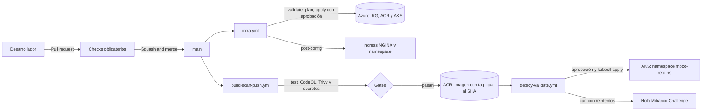

# mbco-devsecops

Reto técnico para Líder Técnico DevSecOps. Despliega un AKS (`aks-mbco-reto`) con Terraform desde GitHub Actions, construye un microservicio Java 21 / Maven 3.9, lo publica en Azure Container Registry y lo despliega en el cluster con validación automática. Todo el acceso a Azure es por OIDC, sin secretos guardados.

Mientras el cluster esté encendido, la aplicación responde en http://4.152.185.214/ con `Hola Mibanco Challenge`.

## Contenido del repositorio

| Carpeta | Qué tiene |
|---|---|
| `infra/bootstrap/` | Tres scripts que se ejecutan una sola vez para dejar Azure listo (proveedores, estado de Terraform e identidad OIDC) |
| `infra/terraform/` | Resource group, ACR y AKS. El estado se guarda en Azure Storage |
| `app/` | Microservicio Spring Boot, Maven Wrapper y Dockerfile multi-stage |
| `deploy/` | Manifiestos de Kubernetes (Deployment, Service, Ingress, HPA) con kustomize |
| `.github/workflows/` | `infra.yml`, `build-scan-push.yml` y `deploy-validate.yml` |

## Arquitectura



Cómo viaja el tráfico: internet → IP pública del balanceador → Ingress NGINX → Service (ClusterIP) → pod de la app.

Los tres workflows se autentican en Azure con la misma identidad de GitHub (OIDC). El estado de Terraform vive en un Storage Account aparte (`rg-mbco-tfstate`), para que el pipeline y cualquier otra ejecución vean lo mismo.

## Estrategia de ramas y gestión de cambios

Uso GitHub Flow: una sola rama permanente (`main`) y ramas cortas que se fusionan por pull request.

- Nombres de rama con prefijo: `feat/`, `fix/`, `infra/`, `ci/`, `docs/`.
- Commits con el formato `tipo(alcance): qué hace`, por ejemplo `infra(terraform): add resource group, ACR and AKS cluster`.
- Todo cambio entra por PR y se fusiona con squash, así `main` queda lineal y cada PR es un commit.
- Protección de `main`: PR obligatorio, historia lineal, sin force-push ni borrado, conversaciones resueltas y reglas aplicadas también a administradores. Además exige que pasen seis checks: `test`, `codeql`, `dependency-review`, `secrets-scan`, `image` y `CodeQL` (resultado de code scanning).
- Las aprobaciones de reviewers están en 0 porque trabajo solo y no puedo aprobar mi propio PR. El control real son los checks automáticos y la aprobación manual de los despliegues (más abajo).

Elegí GitHub Flow y no GitFlow porque hay un solo ambiente: una rama `develop` aportaría merges extra sin un ambiente que justifique la separación. Si hubiera dev, qa y prod, pasaría a promoción entre Environments.

## Cómo ejecutarlo

### Requisitos

- Suscripción de Azure en la que tengas rol Owner (hace falta para asignar roles).
- Azure Cloud Shell (Bash). Lo uso en vez de `az` local porque con una cuenta personal de Microsoft y Security Defaults activos la CLI local falla con `AADSTS530035`.
- Un fork o copia de este repositorio en tu cuenta de GitHub, con Actions habilitado.

### 1. Preparar Azure (una sola vez, en Cloud Shell)

Primero elige dos nombres. Los dos deben ser únicos en todo Azure y llevar solo minúsculas y números, y los que uso yo (`stmbcotfstate` y `acrmbcoreto`) ya están tomados:

- `STORAGE_NAME`: de 3 a 24 caracteres, para el Storage Account del estado de Terraform.
- `ACR_NAME`: de 5 a 50 caracteres, para el registry.

```bash
git clone https://github.com/<tu-usuario>/mbco-devsecops.git
cd mbco-devsecops/infra/bootstrap

export STORAGE_NAME=<nombre-unico-del-storage>

bash register-providers.sh
bash create-state-backend.sh
GITHUB_REPO=<tu-usuario>/mbco-devsecops bash create-oidc-identity.sh
```

El ACR se crea después, desde `infra.yml`, con el nombre que pongas en la variable `ACR_NAME` del paso siguiente. Los tres scripts se pueden repetir sin romper nada.

Al terminar, `create-oidc-identity.sh` imprime los tres valores de identidad que hacen falta en el paso siguiente.

### 2. Configurar GitHub

En el repo, `Settings`:

1. `Secrets and variables > Actions > Variables`: crear las variables de la tabla de abajo.
2. `Environments`: crear uno llamado exactamente `production` y añadir un required reviewer (tú mismo sirve). El nombre debe coincidir, porque la credencial federada de Azure confía en el subject `environment:production`.
3. `Advanced Security`: activar Dependency graph (lo necesita `dependency-review`). En un repo público el resto (secret scanning, CodeQL) es gratuito.

### 3. Ejecutar los workflows

En `Actions`, en este orden, con `Run workflow` sobre `main`:

1. **infra**: valida, hace el plan, espera tu aprobación en `production` y aplica. Después instala Ingress NGINX, crea el namespace `mbco-reto-ns` y ejecuta `kubectl get nodes`. Tarda unos 8 minutos.
2. **build-scan-push**: compila, pasa los controles de seguridad y publica la imagen en el ACR. El resumen del job muestra el tag, que es el SHA del commit.
3. **deploy-validate**: pide el SHA como entrada (`image_tag`), espera tu aprobación, aplica los manifiestos y valida con `curl`.

Después de la primera vez no hace falta lanzar nada a mano: un PR que toca `infra/` dispara validate y plan; un push a `main` con cambios en `app/` construye y publica la imagen, y al terminar bien dispara el despliegue.

## Variables y secretos

No uso secretos. Todo lo que guardo en GitHub son identificadores, que sin la credencial federada de Azure no sirven para nada.

| Variable | Obligatoria | Para qué |
|---|---|---|
| `AZURE_CLIENT_ID` | sí | App registration que usan los workflows |
| `AZURE_TENANT_ID` | sí | Directorio de Entra ID |
| `AZURE_SUBSCRIPTION_ID` | sí | Suscripción donde se despliega |
| `ACR_NAME` | sí, si no eres el autor (por defecto `acrmbcoreto`) | Nombre del registry, único en Azure |
| `TFSTATE_STORAGE_ACCOUNT` | sí, si no eres el autor (por defecto `stmbcotfstate`) | El mismo valor que `STORAGE_NAME` del paso 1 |

## Controles de seguridad

Corren en cada PR (`build-scan-push.yml`) y bloquean el merge si fallan:

| Control | Herramienta | Qué hace |
|---|---|---|
| SAST | CodeQL (`security-extended`) | Analiza el código Java; el resultado aparece como check y como alertas en la pestaña Security |
| SCA | Dependency Review y Trivy sobre la imagen | Dependency Review bloquea dependencias nuevas con severidad alta. Trivy revisa el jar completo y el sistema base de la imagen |
| Secretos | Trivy (`secret`) y GitHub secret scanning con push protection | Detecta credenciales en el repo; push protection las bloquea antes de entrar |

Release gate por severidad: el job `image` falla con vulnerabilidades HIGH o CRITICAL que tengan corrección disponible (`ignore-unfixed`). Si no existe parche, bloquear no ayuda, así que esas se informan pero no frenan. La imagen solo se publica en el ACR desde `main` y únicamente si pasaron `test`, `codeql` y `secrets-scan`.

Además, Dependabot tiene activadas las alertas y las actualizaciones de seguridad.

## Decisiones y trade-offs

- **Terraform en vez de Bicep.** Sirve para más de una nube, está muy extendido y tiene un ecosistema grande de módulos. A cambio necesita un archivo de estado y un backend, que Bicep no necesita al ser nativo de Azure.
- **Estado en Azure Storage.** El pipeline corre en otra máquina y necesita ver el estado. Es lo que hace repetibles los despliegues. El acceso es con Entra ID, sin claves de la cuenta. Uso LRS porque es un entorno de prueba; en producción usaría ZRS o GRS.
- **OIDC en vez de secretos.** No hay contraseñas que filtrar ni rotar. El token dura minutos y la credencial federada limita qué repo, rama o Environment puede usarlo. Uso el formato inmutable del subject (con los ids de dueño y repo), porque un repo borrado y recreado con el mismo nombre no podría reutilizar una credencial vieja.
- **Roles de la identidad.** `Contributor` para crear los recursos, `Storage Blob Data Contributor` solo sobre el estado, y `Role Based Access Control Administrator` con una condición que le permite asignar únicamente el rol `AcrPull`. Hace falta porque Terraform da `AcrPull` al AKS sobre el ACR y `Contributor` no puede crear asignaciones de rol. Descarté `User Access Administrator` porque permitiría que la identidad se asigne `Owner`.
- **Spring Boot 4.1.2 con Maven Wrapper.** El enunciado pide Maven 3.9.x y mi máquina trae 3.10; el wrapper fija 3.9.16 para cualquiera que lo ejecute, incluido el pipeline.
- **Imagen Alpine, multi-stage, usuario no root.** La imagen final lleva solo JRE y el jar, y corre como usuario `app`. Es más pequeña y tiene menos paquetes que escanear. Las bases están fijadas por versión exacta.
- **Manifiestos con kustomize.** El manifiesto no lleva tag; el despliegue pone el SHA del commit. Así cada despliegue es trazable y no dependo de `latest`.
- **Probes, requests y limits.** `startupProbe`, `readinessProbe` y `livenessProbe` apuntan a actuator. Los requests son necesarios para que el HPA calcule el porcentaje de CPU (1 a 3 réplicas, objetivo 70%). El pod corre sin root, con sistema de archivos de solo lectura y sin capacidades extra.
- **Un nodo `Standard_D2s_v6`.** Para el reto, costo mínimo. A cambio no hay alta disponibilidad hasta que el HPA escale.
- **Aprobación manual en `production`.** Tanto `apply` como el despliegue esperan una aprobación. Como trabajo solo, puedo aprobar mis propios cambios; en un equipo lo haría otra persona.
- **Un paso manual inicial.** El enunciado pide cero manualidad. La identidad del pipeline y el backend de su estado no pueden crearse con el propio pipeline (necesita ambos para arrancar), así que los dejé en tres scripts que se ejecutan una vez. Todo lo demás es por workflow.

## Evidencias

Los runs son públicos. Los más relevantes:

| Qué muestra | Run |
|---|---|
| Primer plan de la infraestructura en un PR | [#42949316921](https://github.com/qb4y/mbco-devsecops/actions/runs/42949316921) |
| Primer apply, **fallido** (`Standard_B2s` no permitido en la suscripción) | [#42950689844](https://github.com/qb4y/mbco-devsecops/actions/runs/42950689844) |
| Apply corregido: AKS creado, `kubectl get nodes`, Ingress NGINX y namespace | [#42951934112](https://github.com/qb4y/mbco-devsecops/actions/runs/42951934112) |
| Controles de seguridad en un PR (tras corregir `dependency-review`) | [#42955246497](https://github.com/qb4y/mbco-devsecops/actions/runs/42955246497) |
| Imagen publicada en el ACR desde `main` | [#42955720039](https://github.com/qb4y/mbco-devsecops/actions/runs/42955720039) |
| Despliegue con aprobación, pods, HPA y `curl` correcto | [#42958306167](https://github.com/qb4y/mbco-devsecops/actions/runs/42958306167) |
| Plan sin cambios tras corregir `upgrade_settings` | [#42960521364](https://github.com/qb4y/mbco-devsecops/actions/runs/42960521364) |

## Problemas que encontré

- **`AADSTS530035` con `az login` en mi máquina.** Security Defaults exige MFA y la CLI local con una cuenta personal no lo cumple. Usé Cloud Shell para el bootstrap. El pipeline no tiene este problema porque es una identidad de máquina.
- **`SubscriptionNotFound` al crear el storage.** El error es engañoso: el proveedor `Microsoft.Storage` estaba sin registrar en la suscripción nueva. Quedó en `register-providers.sh`.
- **`AADSTS700213: No matching federated identity record`.** Mi repo emite el subject con ids (`repo:usuario@<id>/repo@<id>:pull_request`) y yo había registrado el formato con nombres. Azure compara el texto exacto; la solución fue leer el subject que presentó GitHub en el propio error.
- **`The VM size of Standard_B2s is not allowed in your subscription`.** Tener cuota de la familia no significa que el tamaño esté permitido. `plan` no lo detecta, solo `apply`. Cambié a `Standard_D2s_v6`, y el segundo apply creó solo lo que faltaba, sin tocar el resource group ni el ACR.
- **`Dependency review is not supported on this repository`.** Faltaba activar Dependency graph en el repo recreado.
- **Error `429` de Trivy.** Al leer el `pom.xml`, Trivy resuelve dependencias contra Maven Central y la IP quedó limitada. Excluí el `pom.xml` del escaneo de secretos; las dependencias se revisan en la imagen y con Dependency Review.
- **El plan nunca quedaba en "No changes".** Azure rellena valores por defecto en `upgrade_settings` del node pool y Terraform los veía como diferencia. Los declaré en `main.tf`.

## Limitaciones y qué haría en producción

- El API del AKS es público: los runners de GitHub no tienen IP fija. Haría el cluster privado con runners propios, o limitaría el API por rangos de IP.
- Un nodo y una réplica mínima: usaría al menos dos nodos en zonas distintas, `PodDisruptionBudget` y `NetworkPolicy`.
- HTTP sin TLS y sin dominio: añadiría cert-manager y un dominio.
- Trivy marca hallazgos de configuración en `main.tf` (API sin restringir por IP, entre otros). Los dejé como riesgo aceptado del reto; el escaneo de IaC como informe en `infra.yml` queda pendiente.
- Las acciones están fijadas por etiqueta de versión. En producción las fijaría por SHA y mantendría el resto actualizado con Dependabot.
- Estado en LRS con claves compartidas habilitadas: en producción usaría ZRS o GRS, private endpoint y desactivaría el acceso por clave.
- Separaría la identidad del `plan` (solo lectura) de la del `apply`, y acotaría `Contributor` a resource groups en vez de toda la suscripción.
- Despliegue por GitOps (Argo CD o Flux) en lugar de `kubectl apply` desde el pipeline, con rollback automático.

## Limpieza

Para no seguir gastando crédito, desde Cloud Shell:

```bash
az group delete --name rg-mbco-reto --yes --no-wait
az group delete --name rg-mbco-tfstate --yes --no-wait
az ad app delete --id <AZURE_CLIENT_ID>
```

El primero borra el AKS y el ACR; el segundo, el estado de Terraform; el tercero, la identidad del pipeline.
